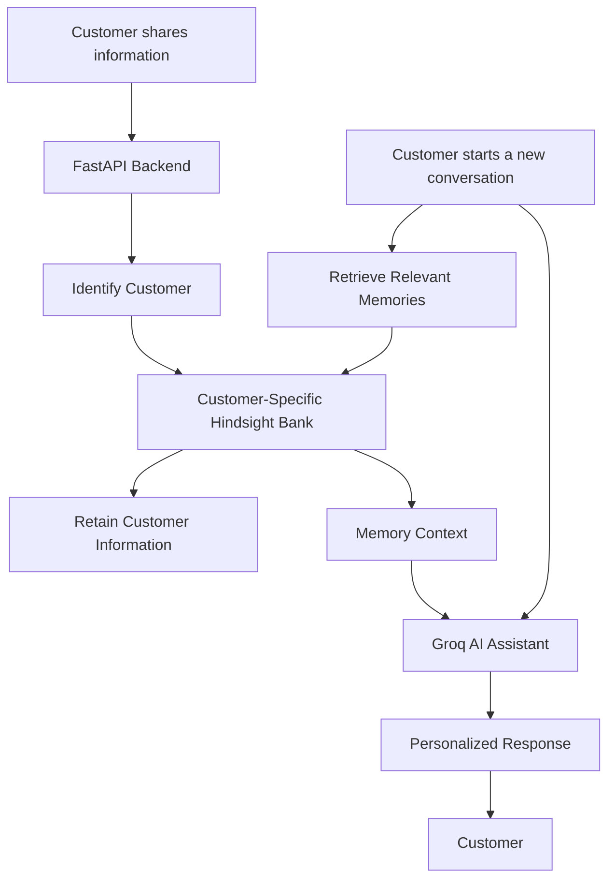
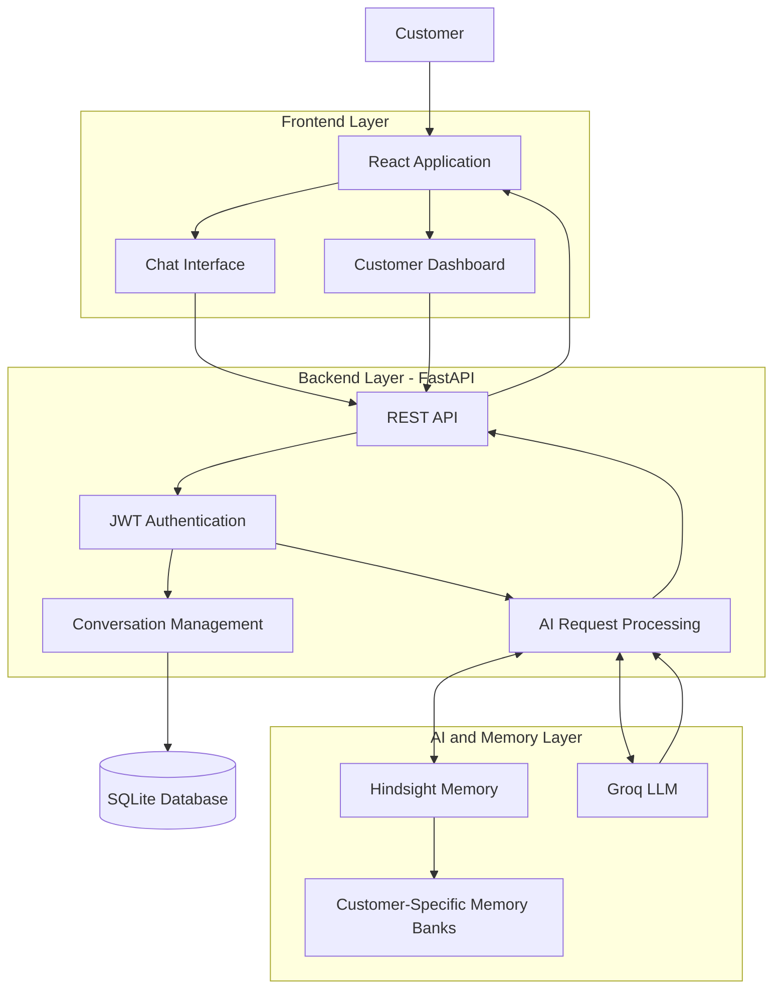
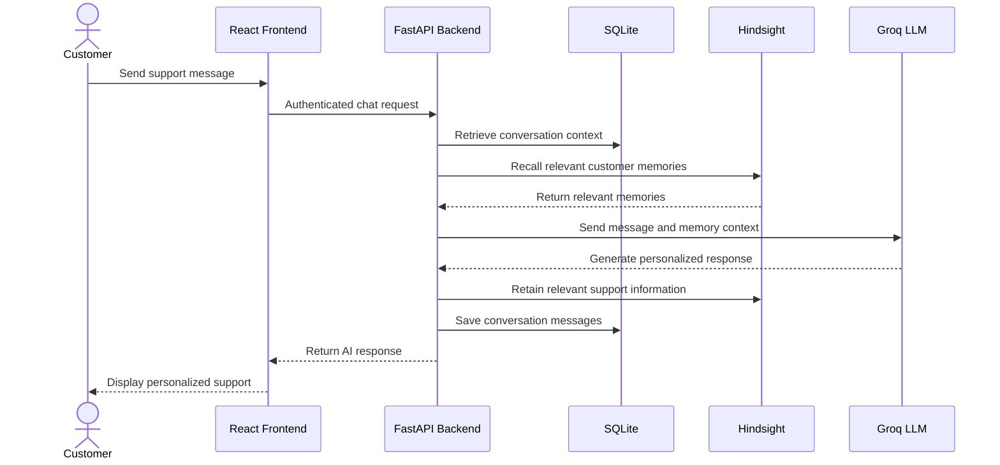

# RecallCare AI 🤖

### AI-Powered Customer Support Assistant with Persistent Memory

RecallCare AI is an intelligent customer support assistant powered by **Groq** and **Hindsight**. Unlike traditional chatbots, it remembers customer information, device details, previous issues, troubleshooting attempts, and communication preferences across separate conversations.

By combining conversational AI with persistent memory, RecallCare AI provides personalized assistance, reduces repetitive questions, and improves the customer support experience over time.

---

## 🚀 Problem Statement

Traditional customer support systems often require customers to explain the same problems, provide device information, and repeat their preferences every time they start a new conversation.

This creates frustrating experiences, wastes time, and makes support less efficient.

**Our Solution**

RecallCare AI addresses this problem using persistent AI memory. It remembers relevant customer information and previous support interactions, allowing the assistant to understand the customer's history and provide more relevant recommendations in future conversations.

## ✨ Key Features

- **AI-Powered Customer Support:** Generates helpful and contextual responses using Groq.
- **Persistent Memory:** Stores and recalls customer information using Hindsight.
- **Cross-Conversation Recall:** Remembers relevant information across separate conversations.
- **Customer Memory Isolation:** Maintains a dedicated memory bank for each customer.
- **Personalized Recommendations:** Uses previous issues and troubleshooting history to suggest appropriate next steps.
- **Preference Learning:** Remembers customer communication preferences and uses updated preferences in future interactions.
- **Conversation History:** Stores and retrieves previous support conversations.
- **Memory Insights Dashboard:** Organizes remembered information into meaningful categories.
- **Authentication:** Supports customer registration and login using JWT authentication.
- **Reduced Repetition:** Avoids asking customers to repeat information already available in memory.

---

## 🧠 How Hindsight Powers RecallCare AI

Hindsight is the persistent memory layer at the core of RecallCare AI.

It enables the assistant to retain relevant customer information and retrieve it when needed in future conversations.

### Memory Workflow



### What the Assistant Remembers

| Memory Category | Example |
|---|---|
| Device Information | Dell Inspiron 15 laptop |
| Reported Issues | Rapid battery drainage |
| Troubleshooting History | Power settings adjusted; background apps disabled |
| Battery Health | 42% of original design capacity |
| Communication Preferences | Phone support |
| Previous Support Activity | Warranty and battery replacement discussions |

### Key Memory Capabilities

1. **Retain:** Stores relevant customer information and support interactions.
2. **Recall:** Retrieves relevant information when the customer sends a new message.
3. **Personalize:** Supplies recalled information to the Groq-powered assistant.
4. **Learn from updates:** Retains changed customer preferences and new support information.
5. **Isolate:** Uses separate memory banks for individual customers.

---

## 🏗️ System Architecture

The application follows a frontend-backend architecture with separate AI and persistent memory services.



### Technology Responsibilities

- **React:** Provides the customer-facing interface.
- **FastAPI:** Handles API requests, authentication, conversations, and AI orchestration.
- **Groq:** Generates contextual customer support responses.
- **Hindsight:** Retains and recalls persistent customer information.
- **SQLite:** Stores customer accounts and conversation history.
- **JWT:** Protects authenticated customer endpoints.

---

## 🔄 Customer Support Request Flow

The following diagram illustrates how RecallCare AI processes a customer message.



---

## 🛠️ Technology Stack

| Component | Technology |
|---|---|
| Frontend | React.js |
| Build Tool | Vite |
| Backend | Python, FastAPI |
| AI Model Provider | Groq |
| Language Model | `openai/gpt-oss-120b` |
| Persistent Memory | Hindsight |
| Database | SQLite |
| Authentication | JWT |
| API Documentation | FastAPI Swagger UI |

---

## 📁 Project Structure

```text
RecallCare-AI/
│
├── backend/
│   ├── ai_agent.py
│   ├── auth.py
│   ├── database.py
│   ├── init_db.py
│   ├── main.py
│   ├── memory.py
│   ├── models.py
│   ├── schemas.py
│   ├── migrate_old_conversations.py
│   └── requirements.txt
│
├── frontend/
│   ├── public/
│   ├── src/
│   │   ├── assets/
│   │   ├── components/
│   │   ├── pages/
│   │   │   ├── Chat.jsx
│   │   │   ├── Dashboard.jsx
│   │   │   ├── Login.jsx
│   │   │   └── Register.jsx
│   │   ├── services/
│   │   ├── App.jsx
│   │   ├── App.css
│   │   └── index.css
│   ├── package.json
│   └── vite.config.js
│
├── .gitignore
└── README.md
```

---

## ⚙️ Setup and Installation

### Prerequisites

Install the following before running the project:

- Python 3.10 or later
- Node.js and npm
- Git
- Groq API key
- Hindsight API credentials and service URL

### 1. Clone the Repository

```bash
git clone https://github.com/rakeshn7/RecallCare-AI.git

cd RecallCare-AI
```

### 2. Backend Setup

Open a terminal:

```powershell
cd backend

python -m venv venv
```

Activate the virtual environment on Windows:

```powershell
.\venv\Scripts\Activate.ps1
```

Install the backend dependencies:

```powershell
pip install -r requirements.txt
```

### 3. Configure Environment Variables

Create a `.env` file inside the `backend` directory.

Configure the following variables with your own credentials:

```env
GROQ_API_KEY=your_groq_api_key
GROQ_MODEL=openai/gpt-oss-120b

HINDSIGHT_BASE_URL=your_hindsight_base_url
HINDSIGHT_API_KEY=your_hindsight_api_key

SECRET_KEY=your_jwt_secret
```

**Important:** Never upload your actual `.env` file or API keys to GitHub.

### 4. Start the Backend

From the backend directory:

```powershell
uvicorn main:app --reload
```

Backend URL:

`http://127.0.0.1:8000`

API documentation:

`http://127.0.0.1:8000/docs`

### 5. Frontend Setup

Open another terminal:

```powershell
cd frontend

npm install

npm run dev
```

Open the application:

`http://localhost:5173`

---

## 🧪 Persistent Memory Demonstration

The following scenario demonstrates how RecallCare AI uses Hindsight to provide personalized support across conversations.

### Example Scenario

**Step 1 — Initial Customer Interaction**

A customer reports:

> I own a Dell Inspiron 15 laptop. Its battery drains quickly, even with light usage. I prefer email support.

RecallCare AI retains the relevant customer information.

**Step 2 — Previous Troubleshooting**

The customer tries adjusting power settings and disabling unnecessary background applications.

The assistant retains the troubleshooting history.

**Step 3 — Customer Updates a Preference**

The customer says:

> I previously preferred email support, but now I prefer phone support. Please update my preference.

RecallCare AI retains the updated preference.

**Step 4 — New Conversation**

The customer starts a separate conversation and asks:

> What do you remember about my laptop and previous battery issue?

The assistant recalls relevant information without requiring the customer to repeat it.

**Step 5 — Personalized Recommendation**

The assistant considers the battery health, previous troubleshooting attempts, and latest contact preference before recommending an appropriate next action.

### Demonstrated Outcome

- Persistent memory across separate conversations.
- Recall of device and issue information.
- Recognition of previous troubleshooting attempts.
- Updated customer preference recall.
- Personalized recommendations based on support history.

This demonstrates how persistent memory can improve customer support beyond a single chatbot conversation.

---

## 🔐 Security and Data Protection

- API keys and sensitive environment variables are excluded from Git.
- Customer authentication uses JWT.
- Customer memory is organized into separate Hindsight memory banks.
- Customer-specific information should remain isolated.
- Database and API access are handled through the backend.

---

## 🌍 Real-World Impact

RecallCare AI aims to make customer support more efficient and personalized.

Potential benefits include:

- Reducing repetitive customer explanations.
- Helping support teams understand previous customer issues.
- Avoiding repeated troubleshooting suggestions.
- Remembering customer communication preferences.
- Improving continuity between support conversations.
- Enabling more relevant and personalized recommendations.

---

## 🎯 Project Goal

To transform traditional customer support into a personalized, memory-driven experience by combining conversational AI with persistent memory.

RecallCare AI demonstrates how AI agents can use information from previous interactions to provide more useful assistance over time.

---

## 👨‍💻 Author

**Rakesh N Lamani**

GitHub: [@rakeshn7](https://github.com/rakeshn7)

**Repository:** [RecallCare AI](https://github.com/rakeshn7/RecallCare-AI)

---

Built with ❤️ using React, FastAPI, Groq, and Hindsight.
